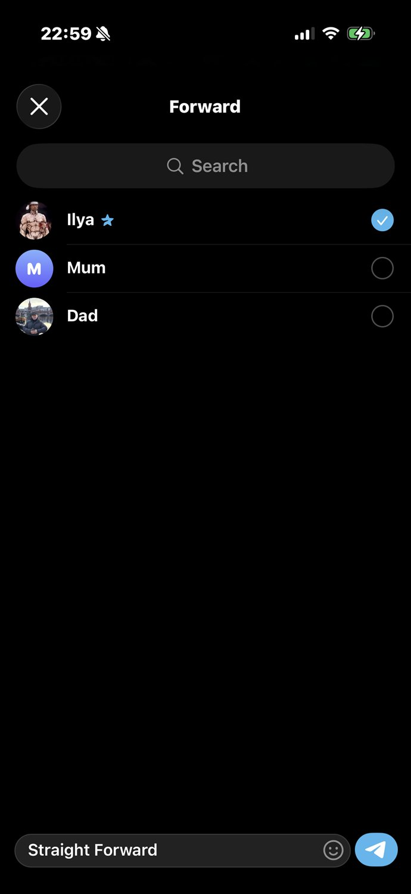
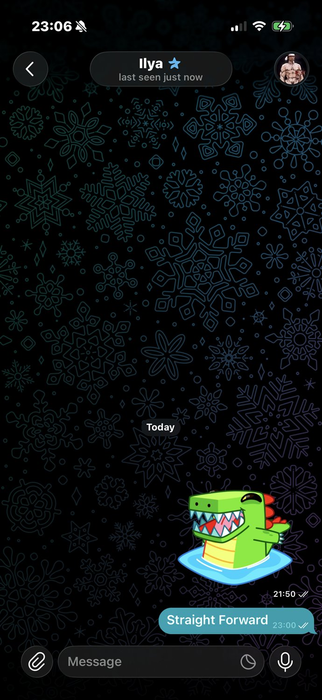
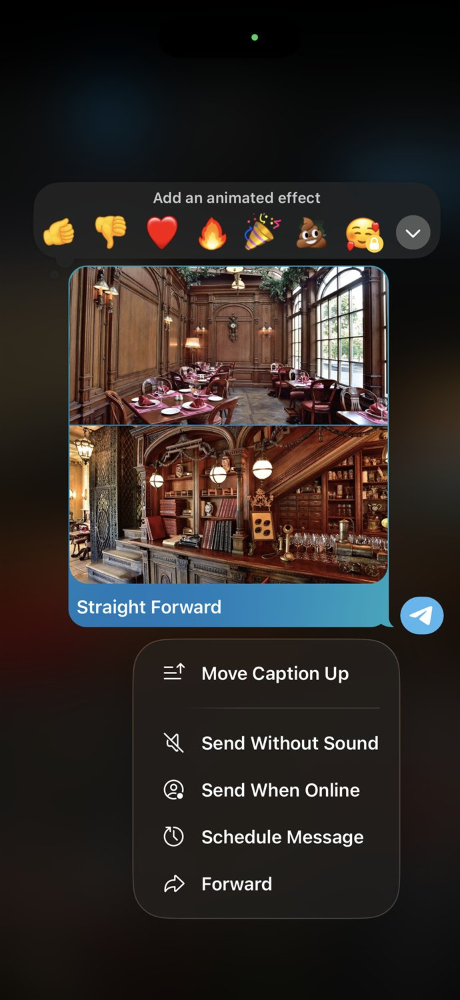

# Straight Forward: send one message to several private chats

Write a message, long-press **Send** and choose **Forward**: the message goes straight to several people at once, each in
their own private chat, without a "Forwarded from" label. Works for text and for a batch of photos. In a usability test,
sharing was 33% faster than with the existing Forward.

  
  
  
  

## Why

People often want to share a personal update, holiday greetings or a set of vacation photos with several friends or family
members individually, without creating a group chat. Today this takes too many steps:

- **Too many steps.** The message has to be sent to one person first, then selected and forwarded to the others.
- **Unwanted attribution.** A forwarded message shows "Forwarded from" with the sender's own name, which makes it feel less
  personal. Hiding it is a separate, manual step, and most people don't know it exists.
- **Fragmented photo sharing.** A message holds up to 10 photos, so a large collection ends up split across several messages
  that all have to be selected and forwarded.

In interviews with 8 Telegram users, sharing vacation and family photos and sending holiday greetings were the most common
cases. Most participants felt uncomfortable receiving a message "forwarded from" the sender themselves.

## What it does

### 1. Forward from the Send button

Long-pressing a sent message opens a menu with **Forward**. The same gesture on the **Send** button opens a menu with enough
room for that same option, so **Forward** is added there too.

### 2. The current chat is preselected

**Forward** opens the familiar sheet, but without the **Select** step: the person of the chat where the message was written is
already selected, so you only add the other recipients.

### 3. No sender name

The message is sent as an original message in every chat. The sender's name is hidden automatically, with no extra steps.

### 4. Photos too

The **Send** button that appears after attaching photos gets the same **Forward** option, so a photo batch can be shared with
several people as easily as text.

## Results

A moderated usability test of the working build, with the same 8 participants. With no hints, 7 of 8 found Straight Forward
on their own. Each sharing task was then timed with and without it:

| Share with several people | Forward | Straight Forward | Time saved |
| ------------------------- | ------: | ---------------: | ---------: |
| Text message              |    18 s |             14 s |        22% |
| One photo                 |    23 s |             17 s |        26% |
| Large photo batch         |    43 s |             25 s |        42% |
| **Average**               | **28 s** |      **18.7 s** |    **33%** |

## More

The design was built directly in the source code of Telegram for iOS, for the Telegram Designers contest. The full case study,
with the research, before-and-after screens and a demo video, is at
[marinakuzminchuk.github.io/telegram-straight-forward](https://marinakuzminchuk.github.io/telegram-straight-forward/).
